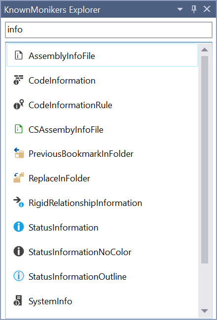
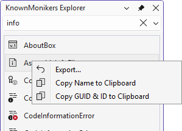
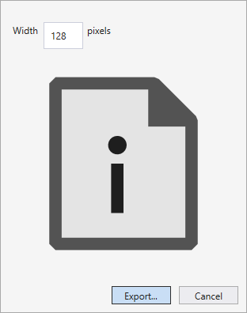
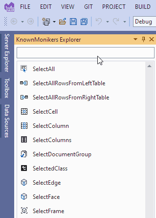

[marketplace]: <https://marketplace.visualstudio.com/items?itemName=MadsKristensen.KnownMonikersExplorer2022>
[vsixgallery]: <https://www.vsixgallery.com/extension/c38f3512-4653-4d97-a4c5-860a425209f6>
[repo]: <https://github.com/madskristensen/KnownMonikersExplorer>

# KnownMonikers Explorer

[](https://github.com/madskristensen/KnownMonikersExplorer/actions/workflows/build.yaml)


Download this extension from the [Visual Studio Marketplace][marketplace] or get the [CI build][vsixgallery]

--------------------------------------

**A tool window for Visual Studio extension authors** that lets you easily browse all the image monikers in the KnownMonikers catalog.

## Features

### Browse and Search

Open the tool window from **View → Other Windows → KnownMonikers Explorer** and filter image monikers by typing in the search box.

The window displays a loading message while the catalog initializes. Search and Find Moniker wait for initialization, and clearing or replacing a search cancels the previous request.



### Context Menu Actions

Right-click any moniker for a list of actions:



| Action | Shortcut | Description                                        |
| ------ | -------- | -------------------------------------------------- |
| Export | `Enter`  | Export moniker to PNG, JPEG, or GIF at custom size |
| Copy   | `Ctrl+C` | Copy moniker name to clipboard                     |

### Export Dialog

Export the image moniker to file in the size you specify. PNG, JPEG and GIF formats are supported.

Image widths from 1 to 4096 pixels are supported. Invalid sizes disable export, unsupported file extensions are rejected, and export failures are shown in the dialog with diagnostic details logged to the Output window.



### Find Moniker in Visual Studio

Hover the mouse over an image moniker in Visual Studio (for example, an image on a toolbar button) and press `Ctrl+Shift+Alt+Q`. The KnownMonikers Explorer window will open and highlight the image moniker.



## Requirements

- Visual Studio 2022
- Visual Studio 2026

## Building from source

Open `KnownMonikersExplorer.slnx` in Visual Studio with the **Visual Studio extension development** workload and the .NET Framework 4.8 targeting pack installed. The extension uses an SDK-style VSIX project.

Build with Visual Studio MSBuild:

```powershell
msbuild KnownMonikersExplorer.slnx /restore /p:Configuration=Release /p:DeployExtension=false
```

The VSIX is written to `src\KnownMonikersExplorer2022\bin\Release\KnownMonikersExplorer2022.vsix`. Use **Debug / Any CPU** and press **F5** to deploy and debug in the experimental instance.

Assembly metadata remains in `Properties\AssemblyInfo.cs` so it continues to use the manifest-generated `Vsix` constants and CI version stamping.

### Tests

The solution includes .NET Framework 4.8 MSTest regression tests. Run them from Visual Studio Test Explorer or, after building, use:

```powershell
dotnet test tests\KnownMonikersExplorer.Tests\KnownMonikersExplorer.Tests.csproj --configuration Release --no-build --no-restore --settings tests\KnownMonikersExplorer.Tests\CodeCoverage.runsettings --collect "Code Coverage;Format=Cobertura"
```

The GitHub Actions build runs the tests before publishing, reports TRX results, summarizes line and branch coverage, and uploads test results and coverage reports.

Unit tests exercise catalog metadata, query matching and normalization, cancellation while filtering, size validation, and image encoding to in-memory streams. They do not construct VS-hosted tool windows, mock shell services, or validate the Visual Studio image service. Encoded images are decoded to check dimensions, pixel data, and PNG transparency; unsupported extensions and stream failures are also covered.

#### Visual Studio integration smoke checks

Use F5 to run the extension in an experimental instance. These checks require a live Visual Studio host and are not substitutes for unit tests:

1. Open the explorer and immediately enter a query. When loading finishes, verify the query is still applied and the loading message disappears.
2. Rapidly replace a query, then clear it. Verify old results never replace the newest query or the restored full catalog.
3. Invoke Find Moniker on a known toolbar image before opening the explorer. Verify it selects the image instead of reporting it as unknown. Repeat while a filter excludes that image, and verify the filter clears. Check a custom/unknown moniker separately.
4. Export a known image at 16 and 32 pixels in light and dark modes. Verify dimensions and the appearance match the preview. Cancel the save dialog and verify the export dialog remains usable.
5. Try an unsupported extension and an unwritable destination. Verify a visible error, a usable retry button, and no modification to an existing file with the unsupported extension. Click Export repeatedly during an export and verify only one operation is active.

These host-dependent checks must be run explicitly; a passing unit-test run does not imply they passed.

## Related Resources

- [Image Service and Catalog](https://msdn.microsoft.com/en-US/library/mt628927.aspx)
- [Image Library Viewer](https://msdn.microsoft.com/en-us/library/mt629250.aspx)
- [Glyph List](http://glyphlist.azurewebsites.net/)

## License

- This extension: [Apache 2.0](LICENSE)
- [License for the images](https://www.microsoft.com/download/details.aspx?id=35825)

## How can I help?

Give it a rating on the [Visual Studio Marketplace][marketplace] or report issues on [GitHub][repo].
